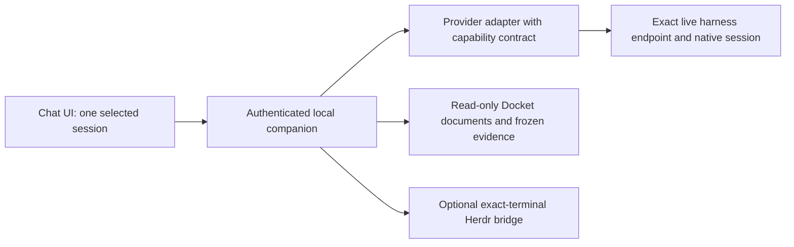

# Docket chat UI design

Approved design direction, 2026-10-08. This supersedes the terminal-first product direction in
[the POC plan](frontend-implementation-plan.md), while retaining its tested bridge
as a possible fallback. The user's preferred main surface is a chat-style view.

**Hard requirement:** every harness continues in its default interactive TUI/CLI
mode. The companion attaches alongside that running process. No headless agent,
SDK-controlled replacement, separate execution engine, auto-resume, or fork is
part of this design. Documentation for those APIs is capability research only.

The user adopted Astra's review from Docket discussion C01: retain the layout,
use the palette below, and prove ordinary same-session chat before adding native
question and permission controls. Full parity across harnesses remains unproven.

## What the POC established, and what it did not

The user saw a terminal projection but could not meaningfully interact with it.
They may also have seen several roles from one window, but do not remember whether
this meant a combined display or entries in the picker. That symptom is unresolved.
The current code targets a terminal ID, not a whole Herdr window; no reproduction
has established why several panes might have appeared together.

Confirmed from the code:

- Every binding initially opens in observation mode. Input stays disabled until
  the separate Take control action succeeds. Switching or reconnecting returns
  to observation, so an apparently live screen can be non-interactive.
- The candidate picker lists all project terminals for every role. A terminal can
  be manually linked to several unrelated roles, with no semantic role check.
- Bindings disappear on page reload. Window/pane placement is not a Docket session
  identity. Tests covered disposable shells, not live native agent sessions.
- The bridge pins foreground process-group identity for detected agents. Whether
  ordinary tool activity invalidates a real harness binding needs reproduction.
  A changing tool process must not be mistaken for a replacement agent.

The next product should give each agent session a conversation, a visible recipient,
and usable answers and actions, independent of its terminal arrangement.

## Reviewable visual prototype

Open [the interactive design](frontend-design/index.html). It uses fictional sample
data for `Documents/Projects/test`, not the live run. It exercises role/session
navigation, a current implementor with collapsed earlier task sessions, a message composer, question choices,
tool permission cards, activity details, a document drawer, draft preservation,
and an explicitly limited history-only session. All actions remain in the mock.

## Information architecture

### Palette and typography

| Token | Value |
| --- | --- |
| Canvas / surface / sidebar | `#F6F8FB` / `#FFFFFF` / `#F1F4F7` |
| Primary / secondary text | `#17212B` / `#52606D` |
| Accent / focus | `#2563EB` |
| Selected session fill / text | `#EAF1FF` / `#1E40AF` |
| Decorative separator / control border | `#D7DEE7` / `#64748B` |
| Permission fill / text | `#FFF7E6` / `#92400E` |
| Success fill / text | `#ECFDF3` / `#166534` |
| Error | `#B42318` |

Use 15-16px conversation text, 13-14px controls and at least 12px metadata.
Selection is blue, pending permission is amber, and a named success is green.
Color accompanies text or an icon. Progress names the recorded metric rather
than treating a reviewer rejection as completion. The session source replaces
the universal window-placement footer; topology remains incidental context.

```text
Project: ~/Documents/Projects/test       Run: R01        2 need you
┌───────────────────┬──────────────────────────────────┬──────────────────┐
│ Role sessions     │ Planner · r01-planner             │ Run context      │
│                   │ Chat available                   │                  │
│ Planner           │                                  │ Plan             │
│ Orchestrator      │ Conversation | Activity | Terminal│ Task             │
│ Implementor · T03 │                                  │ Report           │
│ ▸ Earlier tasks  │ You: Build a chat UI...            │ Verification     │
│   (collapsed)    │ Agent: Here is the plan...         │ Decision         │
│ Verifier          │ Tool: Read architecture [details] │                  │
│ Reviewer          │ Question: Should files be editable│ Document body    │
│                   │ [Read only] [Allow editing]       │                  │
│                   │ [Submit answer]                   │                  │
│                   │                                  │                  │
│ Run progress      │ Message Planner...       [Send]   │ Evidence links   │
└───────────────────┴──────────────────────────────────┴──────────────────┘
```

The project selector manages an explicit list of added directories. Adding a
directory is a read-only discovery operation; it creates no run and launches no
agent. Project selection determines the Docket run inventory. A run determines
the applicable roles. A role expands into its registered sessions. The centre
always displays exactly one selected session, except for an explicitly labelled
run-wide activity page, which is outside the first iteration.

Normally show one **Implementor** entry for the current task. In the standard
workflow each completed task's harness stops and the next task reuses the prepared
pane. Put previous task sessions in an **Earlier tasks** section collapsed by
default. Keep their transcripts readable and their requests expired or resolved.
The new native session and generation get a distinct conversation, draft and live
authority even when the pane is reused. If a run explicitly has concurrent active
workers, expand the current role into those workers; do not invent parallel workers
from historical registration records. Changing the active task is not permission
to relaunch an old session when its history is opened.

The header names the recipient and live connection status. The composer repeats
that recipient. A global Needs you button navigates to a specific pending request
without answering it. Tool permission and question badges are independent of
Docket task lifecycle. A verifier pass is never rendered as reviewer approval.

The right drawer renders Markdown documents and links to the exact source.
Submitted evidence links use their frozen bundle addresses; live drafts are
labelled live drafts. Missing or damaged evidence must remain visible as unavailable.
Opening documents does not acknowledge agent events or edit lifecycle frontmatter.

## Session identity and shared windows

| Situation | Expected UI |
| --- | --- |
| Planner and reviewer are split in the same window | Two separate conversations, each bound to its own native session |
| Five roles are split across several windows | The same role sidebar and conversations; layout does not affect routing |
| Two implementors are active | Two named worker entries with task and session identity, never one merged chat |
| Sequential tasks reuse the implementor pane | One current Implementor entry; earlier native sessions sit in collapsed, inert history |
| A recorded combined role uses one harness session | One shared session labelled with its recorded responsibilities; role aliases point to that same conversation |
| Two unrelated roles are accidentally linked to one terminal | Refuse the conflicting mapping unless the run's recorded combined policy permits it |
| A process renders an entire multiplexer UI inside a terminal | Offer it only as an unclassified terminal; do not attribute its composite screen to an agent |
| A native session or generation changes | Keep history accessible, invalidate pending requests and input, and request an explicit relink |
| Another run uses the same project | Its sessions stay outside the selected run unless explicitly inspected separately |

A binding includes canonical project, run, logical responsibilities, physical
Docket session and generation, adapter kind, provider endpoint identity, native
session ID, and optional Herdr terminal/server identity. Panes and window labels
are discovery context, not message destinations. Display a proposed mapping and
its evidence before confirming an ambiguous existing session. Never pick the
newest session, infer a role from the screen title alone, or allow an alias to
silently inherit another agent's pending approvals.

## Implemented history and terminal slice

The live companion now uses this layout with saved provider messages, expandable
tool records, separate session drafts, collapsed earlier implementor tasks, and a
real Herdr terminal tab. History comes from exact project-recorded OpenCode,
Codex, or Claude session identities and is refreshed every five seconds. It is
bounded, read-only provider history, not a stream of authoritative live requests.
Send is enabled only for a role whose exact session is proven (see the role-first section below), and structured question and permission actions appear only where a provider exposes a verified endpoint.
Everything else uses explicit terminal control, with no automatic draft paste.
Earlier sessions cannot acquire terminal control. Leaving the terminal returns
ownership; reopening it starts read-only.

Read-only projections preserve the actual PTY dimensions on Linux, with pane geometry as fallback, in a scrollable browser panel rather than padding a narrow split screen to browser dimensions.
Actual TUI reflow requires explicit control.

OpenCode saved conversations from the existing `test` run and read-only attachment
to its actual reviewer terminal were verified. Conflicting registration identities
are flagged rather than silently resolved. The static design preview remains a
separate sample of the future richer action interface.

## Role-first connection and recovery

Design agreed in Docket discussion C02 (Claude Opus 5.5 high), implemented as run `ui-ux-20261008`.
It rests on a diagnosis from real data rather than on layout: a planner session ledgered once as `implementor`, native registrations without a dispatch counted as current so one physical session appeared twice, a picker listing every provider session of the project, and an exact send reason that appeared only after a terminal was bound.

**CLI attribution.**
A planner's `--as planner` (or `DOCKET_ROLE`) is respected on its first ledgered command, so planner commands no longer fall into the implementor default.
A registration made explicitly (`arm --session`, `session --register`, `dispatch --register`) from the role's own proven session records that session's native and process identity.
A supervisor arming another role or registering a worker is never attributed to that role and never records its identity.
Historical ledgers are not rewritten.

**One current session per role.**
An implementor is the registration holding the run's active dispatches, several only when several run at once, otherwise the one holding the latest dispatch ("last task T04").
Registrations of one role that record the same native session with agreeing processes merge, and a registration is folded into a dispatch holder only when the dispatch recorded the same pid:start.
Earlier tasks and registrations with no dispatch and no proof collapse into **Earlier tasks** and **Unattributed**.

**Labels and details.**
Roles read as a plain name, one state word with a shape (Live, Working, Needs you, Starting, Not found, Needs link, Ambiguous, Saved only) and a harness, never a UUID.
**Details** holds the exact identity: session name, native session ID, pid:start, pane, attribution, every role Docket recorded for that native session, registrations and any link.
The saved-conversation picker lists this run's sessions and offers the project scope only on request; a choice outside the requested scope is refused.

**Connection strip and composer.**
When a role is not Live one strip gives the exact reason and the one recovery action: link a session, refresh, retry, choose a terminal or open the terminal.
The composer always accepts a draft for a current role, states beside Send why chat is or is not ready whether or not a terminal is bound, and sends on Ctrl+Enter.
Stop is hidden while no harness has a known-safe interrupt.
An earlier session shows one read-only line instead of a composer.

**Explicit association.**
A saved history link alone never confers Send.
A role whose own record has no usable identity can instead be linked, after confirmation, to one of this run's saved sessions, and only when that session's exact native ID and the pid:start recorded beside it prove exactly one live terminal that runs the same harness, reports no different native session and is not another role's.
The link is companion-only and stored as a preference (`associations.json` beside the project list).
It is proved again on every state read and grants nothing once the process, the registration generation, the session or the role's own record changes.
The role reads "linked by you", the recorded role stays in Details, the binding generation changes so earlier bindings and in-flight operations cannot move onto it, and the draft stays with the role.
A manually bound terminal without that proof can be observed and controlled but has no chat.
Codex sessions run inside an app server whose recorded process is not the terminal, so they usually cannot be proven and stay Not found until a native ID is reported.

**Layout.**
One header carries project, run and role, the run status, Herdr health, Refresh and Docs.
The sidebar is a compact role list that becomes a role switcher on narrow screens.
Chat renders the inert Markdown subset: a link reads as its label and literal URL, and a private-URL token is hidden in rendered text while Source keeps the exact bytes.
Documents are optional and remember their state on wide screens; Reading mode gives them the workspace at a readable line length (Escape returns), narrow screens use an overlay, frontmatter is a collapsed Properties row, and the picker groups the plan and each task's latest decision and report first.
The page fits the viewport at 1500px and 390px with no sideways scroll.

## Conversation and action contract

The UI renders structured provider messages and tool events. It never converts
screen blits into fabricated messages or permission cards. The adapter advertises
capabilities independently: read history, stream updates, send a message, steer a
turn, interrupt, answer a question, decide a tool request, and manual terminal.
Missing capabilities remain disabled with a specific next action.

| Session state | Composer and actions |
| --- | --- |
| Live and ready | Send to the explicitly named session |
| Working | Stop; steering or queueing only if the adapter supports that exact operation |
| Waiting for a question | Render the provider's request and choices; answer by request ID |
| Waiting for tool permission | Render operation, target, scope and provider decisions; default to no selection |
| History only | Read messages; show Open terminal or Connect chat; do not imply the composer works |
| Connection lost | Preserve the draft; disable sends and unresolved decisions until reconciliation |
| Session replaced | Preserve history, remove live authority, and show Relink session |

Permission scope follows the provider's request. Do not add a remembered grant,
accept-for-session option, or broadened filesystem/network authority when the
provider did not offer it. Tool permission is distinct from Docket's reviewer
approval; answering a permission card cannot approve a task report.

Outgoing messages pin the session generation and a client operation ID. Question
and permission responses additionally pin their provider request ID and revision.
The adapter confirms delivery or returns an explicit error. A timeout is not proof
of non-delivery; reconcile the operation instead of resending blindly. Locally
queued messages are labelled unsent and scoped to their original recipient.

Drafts and scroll positions are keyed by physical session. Switching roles cannot
retarget a pending send or answer. If another client resolves a request, its card
becomes resolved and loses its active controls. Reconnect first reloads history,
current turn and pending requests, then restores supported actions. Historical
cards never regain authority just because they appear in a transcript.

## Provider architecture and feasibility



Three independently verified integrations are required. These are documentation
findings, not a claim that the existing sessions in `test` already expose working
chat endpoints:

| Harness | Structured interface | Existing-session constraint | Proposed order |
| --- | --- | --- | --- |
| OpenCode | TUI and server logic share execution; an external HTTP listener requires explicit network options in the current source | The existing process must expose its endpoint. Never start `opencode serve` as a substitute. Inspect the installed OpenAPI schema before enabling requests. | First message experiment, subject to endpoint availability |
| Codex | Installed 0.160.1 help exposes a shared app-server daemon, existing-session queueing, and a proxy to its control socket | Promising native attachment path. Prove subscription, shared execution, request ownership and busy-message semantics without restoring or replacing an engine. The current adapter is history-only. | Early experiment alongside OpenCode |
| Claude Code | Remote Control shares an existing interactive session with the vendor browser; interactive hooks can decide some tool permissions | Vendor UI support does not establish a custom Docket API. Hook coverage and request identity are limited. SDK replacement remains excluded. | Separate custom-interface investigation; optional explicit vendor handoff |

Sources inspected on 2026-10-08:
[OpenCode server](https://opencode.ai/docs/server/),
[official OpenAI App Server documentation](https://learn.chatgpt.com/docs/app-server),
the [OpenCode TUI entrypoint](https://github.com/anomalyco/opencode/blob/dev/packages/opencode/src/cli/cmd/tui.ts),
[Claude Remote Control](https://code.claude.com/docs/en/remote-control),
and [Claude permission hooks](https://code.claude.com/docs/en/hooks#permissionrequest).
The recommended ordering is an inference from those interfaces and the user's
OpenCode-based test setup. Endpoint support must be tested against the installed
versions before enabling a capability.

### First live discovery check

On 2026-10-08, four existing OpenCode processes in `Documents/Projects/test`
were inspected read-only. None owned a TCP listening socket, and none had a child
process hosting one. An HTTP companion cannot currently attach to those processes.
No session was restarted, resumed or replaced, and no prompt was sent to them.

This observation matches the current upstream TUI source: without explicit
network options, it uses an internal worker transport. The source is the `dev`
branch, not proof of the installed release's exact implementation. An explicit
`opencode --port 0 --hostname 127.0.0.1` remains an ordinary interactive TUI;
it is a future launch option to validate, not a command to restart these sessions.
The earlier server-documentation summary overstated default endpoint availability.

A dedicated ordinary OpenCode TUI was also attempted in a temporary Herdr pane
with explicit random and fixed loopback ports. It exited during setup before an
endpoint and session could be pinned; no browser message exchange was validated.
The cause is unresolved. This is a failed setup experiment, not proof that the
native HTTP interface is unsupported. The temporary pane was cleaned up, and
the existing project roles were not restarted or controlled. Live chat remains
unimplemented while this attachment prerequisite is unresolved.

Two supervisor registration records also name the same native session despite
different native processes. Treat that mapping as ambiguous until reconciled;
do not attribute a conversation to a role by silently trusting that duplication.

Codex daemon help exposes a proxy to a running control socket. Discovery of that
interface is promising, but does not yet prove a browser connection or live control.

For terminal-only agents, expose genuine readable history where available and the
exact-terminal fallback. If chat cannot attach to a normal running TUI/CLI, report
that unsupported capability rather than launch a headless replacement. Do not
resume, fork, replace or launch an agent merely because a conversation was clicked.
Any future launch must remain a normal interactive TUI/CLI and preserve Docket's
existing registration/dispatch rules. The UI creates no competing lifecycle database.
Companion settings can retain transport bindings, but lifecycle remains in Docket's
documents and native provider state.

## Approved implementation sequence

1. Resolve a single existing OpenCode role to its exact server, project and native
   session. Read that server's schema and test whether it can share the live session
   with its existing TUI. Refuse ambiguity rather than scanning and guessing ports.
2. Render its real history and streamed messages/tool activity. Send one user message
   and prove its reply belongs to that same session, with the original default-mode
   TUI still alive and usable. No second execution engine may handle the message.
3. Reconnect without replaying uncertain sends. Add a second session in the same
   Herdr window and prove separate recipients and drafts during in-flight sends.
4. Investigate existing Codex daemon attachment early, with the same identity and
   coexistence checks. Claude custom attachment is a separate investigation.
5. Add native questions, permission allow/deny, cancellation, other-client-first
   resolution, interrupt, queueing and steering as separate capability gates.
6. Add project/run selection, exact role mappings, multiple implementors, and the
   read-only document drawer around proven provider capabilities.

Local selectors, navigation, drafts and document rendering are straightforward.
History adapters are version-specific and may be partial. Readable history does
not establish authoritative live requests, complete tool records or input access.
Needs-you counts must distinguish unknown/offline from zero. Never implement
busy Send as an assumed synonym for queue or steer.

The first slice succeeds only if chat is interactive on a real harness. A rendered
history or a synthetic button demo alone does not satisfy it. No implementation
estimate should assume that all existing terminal sessions support live attachment.

## Acceptance scenarios

- Three split roles in one window produce three isolated conversations.
- Every harness stays in default interactive TUI/CLI mode and remains usable from
  its original terminal while the browser follows or interacts with the same session.
- A combined physical session shares history only where recorded policy permits it.
- Two same-harness sessions in one directory never receive each other's messages.
- Send, question answers, tool decisions and interrupt reach the exact pinned session.
- Switching away during a send never retargets the operation or its acknowledgement.
- A permission request resolved elsewhere becomes non-actionable before another send.
- A stale generation, restarted provider server, or missing binding disables input.
- History-only and unavailable adapters show honest capability states and a usable fallback.
- Working status never implies Docket acceptance; transcript reading consumes no delivery event.
- Narrow screens retain session navigation, actionable cards, composer and document access.

Before implementation, reproduce the earlier projection-only symptom to separate a
control-acquisition problem from an identity-invalidation or wrong-terminal binding
problem. This diagnosis is independent of the new chat design.
