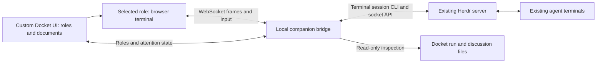

# Docket frontend feasibility

Studied 2026-10-07 against the installed Herdr client and running server, both
**0.8.2, protocol 20**. This is a feasibility study, not a UI implementation.

## Recommendation

Build a **custom Docket interface with a role sidebar and an embedded live
terminal for the selected role**. This directly solves the crowded five-pane
layout: clicking Planner, Orchestrator, Implementor, Verifier, or Reviewer shows
that role in the main area, without zooming a Herdr pane or launching a replacement
agent. The surrounding interface can be fully custom: run selection, task and
review progress, documents, discussion messages, and attention badges.

The terminal remains the interaction surface for agent prompts, questions, and
permissions. Herdr already has an interface designed for third-party terminal
bridges. A completely custom chat interface, including provider-independent
question and permission cards, is a separate and substantially larger project.
Herdr does not provide the structured conversation and interaction data that
would make that a straightforward frontend task.

Most ordinary keyboard-based terminal work is feasible on the installed version.
**Full parity with every native terminal feature is not established**, especially
mouse-driven applications, image clipboard operations, graphics, and complete
historical conversations. Those limits should be explicit before implementation.

## What was verified

The reproducible [probe](feasibility/herdr_bridge_probe.py) starts a disposable,
separate Herdr server using temporary configuration, state, and cache directories.
It creates five shell terminals, exercises the bridge, then stops only that test
server. It never launches an LLM or controls a user's existing pane.
The captured [results](feasibility/herdr_bridge_results.json) show:

| Capability | Evidence | Consequence for the UI |
| --- | --- | --- |
| Five concurrent observers | All five receive an initial full ANSI frame | All roles can have live previews; a single selected role can occupy the main area |
| Live updates | An observer sees the answer typed through a controller | Read-only viewers can follow the same session |
| Question and answer | A synthetic interactive program receives `yes` and prints the result | The bridge can carry user responses |
| Alternate-screen keyboard UI | A raw-mode test receives Down and Enter, then restores its screen | Keyboard selection menus can work through the bridge |
| Interrupt | Base64-encoded Ctrl+C interrupts a running Python process | Terminal control keys can reach the actual process |
| Unicode input | Nepali text and accented Latin text arrive intact | Input is not restricted to ASCII |
| Resize | A full 110 by 28 frame arrives; `stty size` reports 28 by 110 | The selected role can use the browser's available terminal size |
| Recent history | A 300-line read includes the first of 150 generated lines | Available shell scrollback can be read |
| Server-side scroll | Scrolling up produces a 15-line offset | Browser scrolling can request Herdr's viewport history |
| Input ownership | A second controller is refused; explicit takeover closes the first | The UI can detect contention and offer takeover |
| Release and reconnect | Release closes the controller; a new observer gets a full frame and the shell PID is unchanged | Navigating or reconnecting need not restart agents |
| Role switching | Input reaches a second existing terminal | Role navigation does not require pane rearrangement |
| Mouse version limit | `terminal.mouse` is rejected as an unknown command | Do not implement against newer documentation alone |

These tests establish the Herdr transport and PTY behavior. They do **not** prove
browser rendering, clipboard behavior, or every real Claude Code, Codex, and
OpenCode prompt. Those require a small frontend spike and native harness checks.
No Docket product code was changed and the full Docket test suite was not rerun.

Reproduce with Herdr 0.8.2, Python 3, and a POSIX environment:

```sh
python3 docs/feasibility/herdr_bridge_probe.py
```

## Herdr interfaces we can reuse

### Terminal projection and input

The installed CLI offers:

```sh
herdr terminal session observe <target> --cols 120 --rows 40
herdr terminal session control <target> --cols 120 --rows 40
```

Targets can identify a pane, terminal, or unique agent name. Both modes output
newline-delimited JSON frames containing sequence, dimensions, a full-frame flag,
and base64 ANSI bytes. A controller accepts `terminal.input`, `terminal.resize`,
`terminal.scroll`, and `terminal.release`. There can be multiple observers and one
writable direct controller per terminal. The [official bridge documentation](https://herdr.dev/docs/persistence-remote/#direct-terminal-attach)
describes this integration surface; the probe verifies it on the installed release.

A browser terminal such as xterm.js can consume the decoded bytes, render them,
and capture text and keyboard input. Its [official terminal API](https://xtermjs.org/docs/api/terminal/classes/terminal/)
provides `write`, `onData`, `onBinary`, resize, and selection support. A local
backend must connect the browser to Herdr because a browser cannot open a Unix
socket or spawn the CLI directly.

Frames are rendered screen updates, not the original application output stream.
The implementation uses a [screen blit encoder](https://github.com/herdrdev/herdr/blob/v0.8.2/src/server/render_stream.rs).
Preserve frame order and apply a fresh full frame on reconnect. If a frame is
dropped, recreate the stream rather than applying later deltas to an unknown
screen. Concatenating frame bytes is not a reliable way to reconstruct a transcript.

### Role inventory, state, and notifications

Use `session.snapshot` to discover topology, terminal identities, and agent state;
use `agent.list`/`agent.get` for names, native session information when reported,
state, and token metadata. The [socket API](https://herdr.dev/docs/socket-api/)
also provides event subscriptions. Subscribe before the initial snapshot,
reconcile authoritative state after notifications, and take a fresh snapshot after
reconnection. Events invalidate cached state; they are not a complete replayable
history.

The installed schema contains no question, approval, or permission methods, and
`AgentInfo` contains no structured question text or answer choices. The schema
summary is captured in the probe results. An attention badge is possible, but it
must remain a hint: Herdr's [agent detection](https://herdr.dev/docs/agents/)
can rely on screen recognition, and `unknown` does not prove an agent is idle.

`agent.prompt` rejects an agent already blocked at a recognized question or
approval. Responses to such screens should use terminal interaction rather than
treating that method as a universal answer API.

### Documents and discussions

Docket already has durable run plans, tasks, scopes, reports, verification
findings, decisions, and attributed peer discussion messages. These can be
rendered in custom panels without inferring them from terminal output. Discussion
inspection through `--read` and `--list` leaves receipts untouched, as documented
in [ARCHITECTURE.md](../ARCHITECTURE.md).

The terminal should remain available beside these panels. Reading a report does
not establish that its agent received or acknowledged a lifecycle event.

## Limits that affect "everything I do today"

| Workflow | Feasibility on Herdr 0.8.2 |
| --- | --- |
| Read the current role's screen, type prompts, use slash commands | Feasible through projection and input; verify actual harness keyboard behavior in the browser spike |
| Answer text questions or select keyboard-driven permission options | Feasible transport; synthetic prompts passed, native prompts still need verification |
| Ctrl+C, Escape, arrows, function keys | Byte transport exists; Down, Enter, and Ctrl+C passed; validate other keys and browser shortcut conflicts |
| Select and copy visible text | Browser terminal support exists; browser behavior remains untested |
| Paste multiline text | Requires deliberate paste handling; projected frames do not guarantee the browser knows the underlying application's bracketed-paste mode |
| Scroll through all past agent content | Available viewport/history can be accessed; complete alternate-screen application history is not guaranteed |
| Mouse-controlled terminal applications | Installed JSON bridge has no structured mouse command; raw escape forwarding would need correct application mode information and further testing |
| Native image clipboard and terminal graphics | No ready parity through this JSON bridge; a file-upload-to-local-path workflow would be additional integration |
| Custom Markdown chat, tool cards, and permission buttons | Needs harness-specific semantic adapters, not just Herdr frames |
| Existing Herdr TUI alongside the web UI | Processes remain available, but input/resize ownership and concurrent client behavior need a dedicated acceptance check |

The current online docs advertise `terminal.mouse`. The installed 0.8.2
[command enum](https://github.com/herdrdev/herdr/blob/v0.8.2/src/client/mod.rs#L1088-L1120)
does not contain it, and the probe confirms rejection. That bridge's output
handler also does not forward graphics or clipboard messages. Existing graphics
methods in the installed socket schema do not establish image parity for this
terminal stream. A future version can be evaluated separately without upgrading
or restarting live sessions during this study.

For complete conversation history, add a separate transcript panel later.
Docket's existing [sessions module](../skills/docket/docket_cli/sessions.py) locates
Claude Code and Codex transcripts and OpenCode records for usage/archive purposes.
That provides a starting point for reading history, not a complete interactive
chat protocol. Resuming agents through a new native SDK/server could change
session ownership and prompt behavior, so it needs its own design study.

## Proposed architecture



The UI is an optional companion with its own frontend packaging. Keep the current
stdlib-only Docket CLI and installation layout intact. Any dependency decision for
the companion is separate from changing Docket's CLI requirements.

Initially provide a role list, one main terminal, run selector, attention badges,
and document/discussion panels. Implementors may have several task sessions, so a
role should expand into its sessions rather than assume exactly one terminal.
Quick and combined runs should show their actual roles.

On selection, resolve the exact existing terminal, acquire control, and resize it
to the main panel. Release control on switch or disconnect. If another controller
owns it, show a read-only view and an explicit takeover action. Never silently
take over. Background roles can use observers or state subscriptions; five live
streams worked in the probe, but this is not a performance benchmark.

Keep browser navigation local to the companion rather than issuing `agent.focus`
on each click. Herdr focus affects seen state and another client's UI. Likewise,
do not recreate layouts to switch roles: layout reconstruction is not live
terminal preservation.

### Binding roles to the correct session

This is the most important Docket integration gap. Current
[delivery registrations](../skills/docket/docket_cli/delivery.py) record run, role,
session, generation, and name, with native process/session identities for
automatically bound sessions. They do not persist a Herdr pane/terminal binding.
Worker [dispatch records](../skills/docket/docket_cli/dispatch.py) can carry a
Herdr agent name, but that does not cover every supervisor or restart.

Start with an explicit mapping selected from discovered live agents. Later,
record bindings during launches/registrations. Include the Docket workspace, run,
role, session generation, Herdr server identity, terminal ID, and native occupant
identity when available. Revalidate before enabling input and invalidate the
mapping on replacement. Pane IDs can change on workspace moves, and a still-live
terminal can host a different agent. Never resolve ambiguity by guessing the
newest session or a sidebar position.

### Implementation details that matter

- Treat server scroll as the source of history. A browser emulator's local
  scrollback built from screen blits is not an agent transcript.
- Handle transport EOF and stderr errors as well as `terminal.closed`; abrupt
  disconnection need not produce a final JSON record.
- Validate paste and key encoding against the backing application. Prefer Herdr's
  native logical-key/input encoders where mode awareness is needed; do not assume
  xterm's rendered screen establishes the application's input modes.
- A writable bridge controls real shells. Bind locally and authenticate the
  browser connection, check WebSocket origin, and expose the narrow operations
  needed by the UI. Do not expose unrestricted command execution endpoints.
- UI inspection must not claim, acknowledge, or pick up agent delivery events.
  Display file state independently. Future lifecycle actions must call existing
  Docket commands and preserve their gates, locks, and evidence contracts.

## Effort and next step

These are engineering estimates for one developer, not measured delivery times.

| Scope | Estimate | Main uncertainty |
| --- | --- | --- |
| Browser spike: manually bind two roles, render frames, type, switch, resize | 2-4 working days | Actual xterm rendering and harness input modes |
| Usable local companion: five-role navigation, binding checks, reconnect, ownership, state, documents | 1-2 weeks total | Lifecycle identity and input/resize interaction with the Herdr TUI |
| Polished companion with extensive history, upload support, notifications, packaging | 3-5 weeks total | Desired clipboard/graphics parity and supported platform matrix |
| Fully custom interactive chat across all three harnesses | Several additional weeks or more | Native semantic APIs and session ownership; requires separate investigation |

The next implementation should be the browser spike. Its acceptance checks are:
open existing terminals without restarting agents; rapidly switch roles without
misdirected input; respond to real text questions and keyboard permission menus;
test multiline paste, Unicode, shortcuts, scrolling, resize, browser reconnect,
agent replacement, and concurrent use of the original Herdr TUI.

If that passes, the companion can meet the main navigation goal while preserving
terminal interactions. A native custom chat view can be added incrementally where
a harness supplies reliable structured data, with the terminal always available
for interactions that lack such an adapter.
